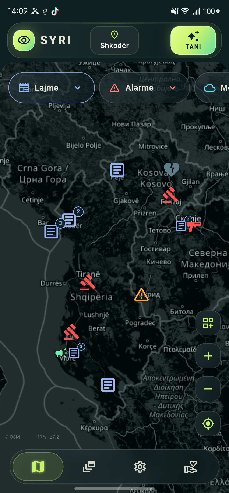
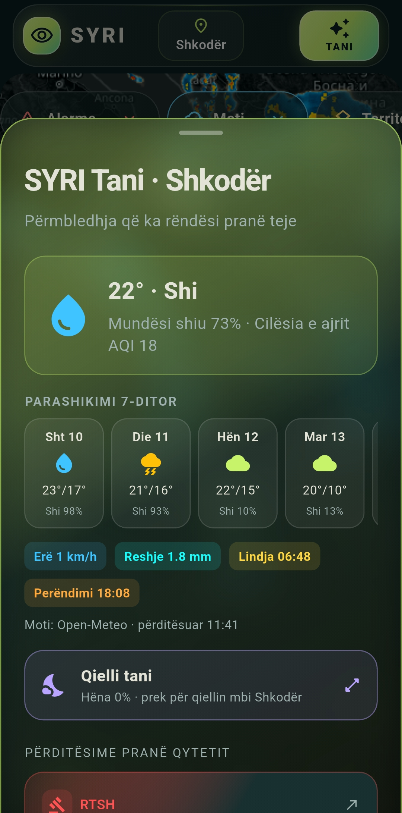
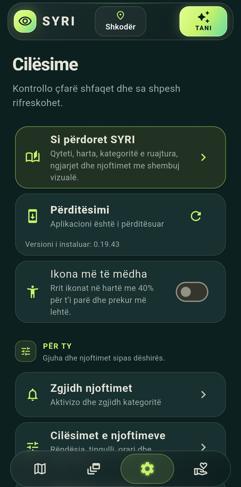

# SYRI — informacioni publik në hartë

SYRI është një aplikacion falas për Android dhe një web app për iPhone që bashkon lajme, alarme, mot, ngjarje dhe të dhëna të tjera publike për Shqipërinë, Kosovën, Malin e Zi dhe Maqedoninë e Veriut. Zgjidh qytetin dhe temat që të interesojnë; për raportimet mund të hapësh burimin origjinal.

  
   
  

| Harta | Ngjarjet | SYRI Tani | Cilësimet |
| :---: | :---: | :---: | :---: |
|  |  |  |  |

## Si ta instalosh

1. Shkarko [APK-në më të fundit](https://github.com/pieroboseta/SYRI/releases/latest/download/SYRI-Android.apk) dhe hape në telefon.
2. Nëse Android e bllokon instalimin, te cilësimet e telefonit lejo instalimin nga shfletuesi ose aplikacioni i skedarëve që përdore për ta hapur. Emrat e menuve ndryshojnë sipas pajisjes. [Udhëzimi i Google](https://support.google.com/pixelphone/answer/7391672?hl=en).
3. Nëse një version prove i firmosur ndryshe nuk përditësohet, çinstalo versionin e provës dhe instalo APK-në e publikuar.

Në iPhone, hap [SYRI Web](https://syri-app.pages.dev/) në Safari. Për ta vendosur në ekranin kryesor, prek **Share → Add to Home Screen**. Versioni web nuk ka të njëjtat njoftime në sfond si aplikacioni Android; informacioni live kërkon internet.

SYRI nuk kërkon llogari dhe nuk ka reklama. Informacioni vjen nga burime të jashtme; kontrollo gjithmonë burimin origjinal për hollësitë dhe ndryshimet. Disa të dhëna të hapura më parë mund të mbeten në cache pa internet, por informacioni live kërkon lidhje.

Ky repository shërben vetëm për **shkarkimet dhe informacionin e aplikacionit**. Kodi burimor nuk publikohet këtu.
